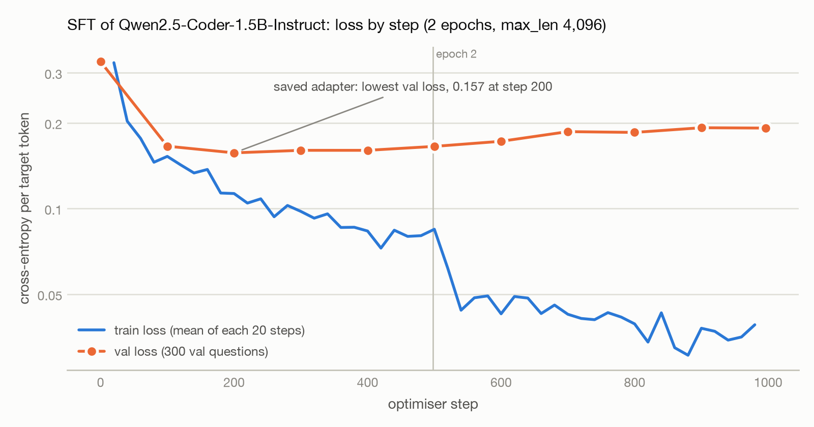
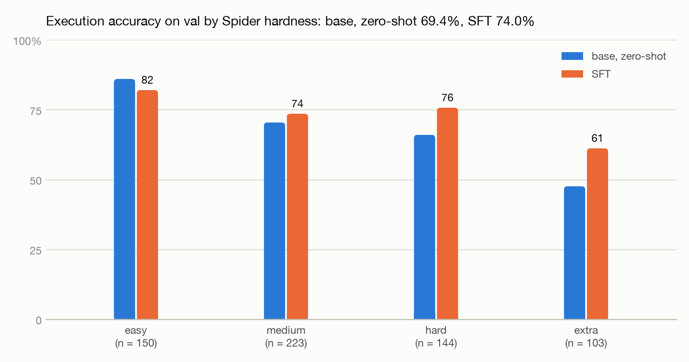
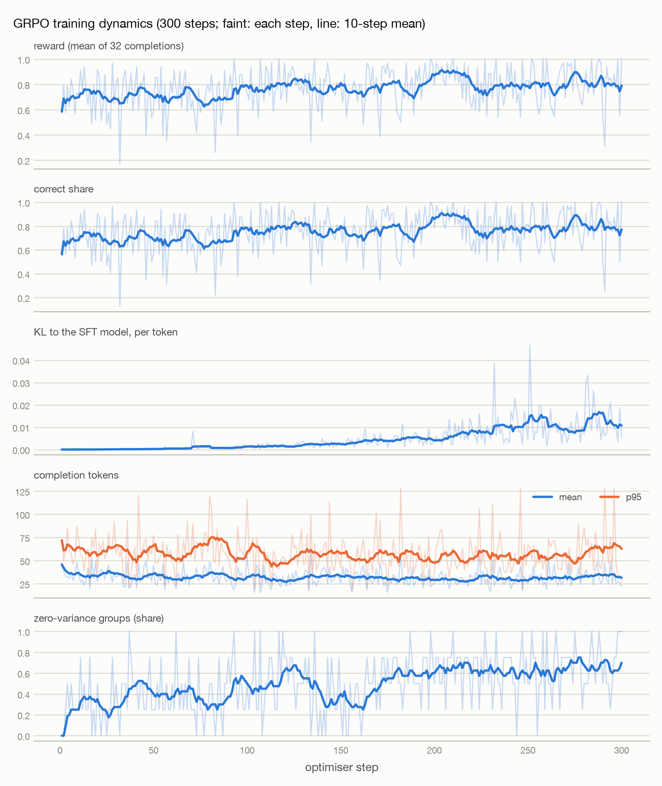
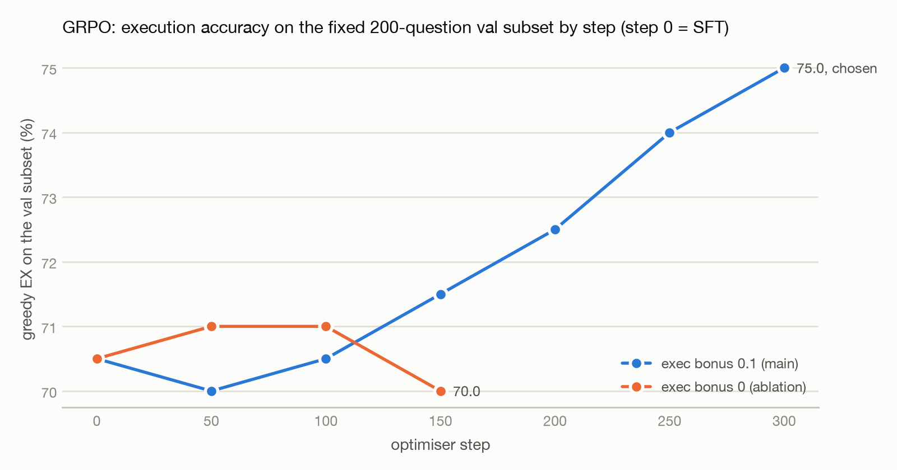

# Design notes

Filled milestone by milestone; each section says what was measured, on which split, and what it changes.

## 1. Data, splits and the harness (M1)

**Release.** Spider 1.0 from the Hugging Face mirror `HAL-9001/spider-databases` (205.8 MB zip, sha256 matches the
published value). It contains the test set: `test.json` (2,147 questions) and `test_database/` (206 databases).

| | Questions | Databases | Gold fails | Gold empty | On empty databases |
|---|---:|---:|---:|---:|---:|
| train (train_spider + train_others − val) | 8,039 | 135 | 3 | 1,597 | 1,759 |
| val (held-out train_spider databases) | 620 | 11 | 0 | 19 | 0 |
| dev | 1,034 | 20 | 0 | 49 | 0 |
| test | 2,147 | 40 | 0 | 54 | 0 |

No database appears in two splits (all six pairs checked). The published counts hold (7,000 / 1,659 / 1,034 / 2,147).
Val is 11 train_spider databases drawn at random (seed 7) among those with at most 90 questions until 600 questions
were reached: cre_Docs_and_Epenses, flight_4, game_1, insurance_fnol, loan_1, local_govt_mdm, pilot_record, race_track,
shop_membership, student_assessment, tracking_grants_for_research. The three failing gold queries are Spider's own
errors (two put `ORDER BY` before `INTERSECT`, one names a table that does not exist); they are never trained on.
Questions whose exact text also appears in train: val 4, dev 4, test 24 — all generic ("How many customers are
there?") and on other databases, since no database is shared.

**Empty databases.** Every table is empty in all six train_others databases (academic, geo, imdb, restaurants,
scholar, yelp) and in music_2: 1,759 train questions. 1,436 of their gold queries return no rows and 323 return one row
of 0 or NULL, so on these databases a query that runs and returns nothing (or `COUNT(*) = 0`) matches the gold result.
For supervised training that is harmless (the target is still correct SQL), so SFT keeps them; for an execution reward
it is free reward, so the GRPO prompt pool leaves them out (`db_empty`). Few-shot examples never come from them (their
prompts show no example rows).

**Empty gold results and the row cap.** Spider's convention scores a prediction that returns no rows as correct when
the gold result is empty too (and the column count matches). That is kept for comparability, and every summary also
reports `ex_nonempty_gold` — EX on the questions whose gold result has rows (val 601 of 620). Results are compared
whole: the row cap is 200,000 (at the original 10,000, 16 gold results were cut — e.g. two flight_4 questions in val
with 10,507 rows; at 200,000 none is).

**Hardness.** `sqltuner/hardness.py` re-implements Spider's easy / medium / hard / extra rule on the sqlglot AST. Checked
against the official `evaluation.py` (taoyds/spider, unmodified, its own parser on each gold query):

| | train | val | dev |
|---|---:|---:|---:|
| agreement, starter port | 97.3% | 95.0% | 97.0% |
| agreement, after the fix | 99.05% (7,962 / 8,038) | 99.19% (615 / 620) | 97.78% (1,011 / 1,034) |

The commonest disagreement was a bug in the port: the helper that counts LIKEs and aggregates "outside nested queries"
started climbing from a node's parent, so a lone `WHERE x LIKE …` or an aggregate placed straight in the SELECT list was
taken for nested and not counted. What remains comes from quirks of the official script that the port does not copy —
it counts a `NOT` condition in WHERE as an aggregation (`SELECT count(*) … WHERE x NOT IN (…)` is extra there, hard
here), counts NOT flags and and/or connectors in HAVING instead of its aggregates, and counts a UNION inside a subquery
once. Dev comes out 248 / 444 / 187 / 155 here against the official 248 / 446 / 174 / 166. Agreement is above 90% on
every split, so the port stays (`eval/results/hardness_check.json`).

**Prompt lengths** (system + `CREATE TABLE` text with 3 example rows per table + question, through each chat template):

| Tokenizer | train p50 / p95 / max | val p50 / p95 / max | SFT sequences over 2,048 tokens |
|---|---|---|---:|
| Qwen2.5-Coder (0.5B and 1.5B share it) | 620 / 2,569 / 4,708 | 812 / 1,688 / 1,732 | train 884 (11.0%), val 0 |
| Qwen3 (0.6B and 1.7B share it; +4 tokens for the empty think block) | 624 / 2,573 / 4,712 | 816 / 1,692 / 1,736 | train 893 (11.1%), val 0 |

The long prompts all come from large schemas. With SFT's `max_len` 2,048, 11% of train would be dropped — and with it
the databases most like a real company schema; that is an M2 decision (raise `max_len` or show fewer example rows on
large schemas). The GRPO pool is 6,116 questions after the skip rules and about 5,090 after its 1,800-token prompt cap.

**The safe executor.** Every model-written query runs through `db.execute`: the database is opened read-only (`mode=ro`
URI and `PRAGMA query_only`), a static guard accepts exactly one SELECT / WITH statement with no write, PRAGMA, ATTACH or
`load_extension` (keywords inside string literals and quoted identifiers do not count), a progress handler aborts
anything past 5 s, and at most 200,000 rows are fetched. Gold SQL skips only the guard; read-only and the timeout always
apply. Tests cover writes refused even for trusted SQL, multi-statements, recursive-CTE runaways and the row cap.

**Why execution accuracy, not exact match.** Spider's exact-set match compares parsed clauses and ignores literal
values: it marks a query with the wrong value as right, and a correct query written another way (different join order,
a subquery instead of a join, `IN` instead of `OR`) as wrong. A model trained with an execution reward is free to write
any equivalent query, so exact match would penalise exactly what RL encourages. Execution accuracy measures what a user
needs — the right rows. Its known weakness is coincidental matches on small databases (two different queries returning
the same rows); the empty-gold case is the extreme of that, hence `ex_nonempty_gold`. Row order counts only when the gold
query has `ORDER BY`; columns may come in any order; floats are compared after rounding.

**Plain greedy decoding.** Qwen2.5-Coder ships `repetition_penalty` 1.05–1.1 in its `generation_config.json`, and
`generate()` applies it even when greedy unless the call overrides it. Left alone, "greedy" would have been penalised
greedy, vote samples would have been penalised samples, and GRPO would have sampled from a different distribution than
the one whose log-probabilities it trains on. `generate.sampling_kwargs` now passes neutral values on every call
(tested against generate's own scores with a Qwen-like config). Qwen3 runs with thinking off (`enable_thinking=False`).

## 2. Baselines on val (M1)

All local models ran zero-shot, greedy, in fp16 on a Kaggle T4 at batch 8. Latency is per question, amortised over the
batch. Claude ran 3-shot, with the examples taken from other databases (medium/hard questions with short schemas), one
request at a time, with the system prompt and the shots cached. Thinking was off for both models (Haiku 5.5
`disabled`, Sonnet 5.5 `between_tools`, its lowest setting). The 5.5 models accept no temperature, so their answers are
sampled at the API's defaults. All numbers are EX in %, with 95% bootstrap CIs.

| Model | n | EX | ex_nonempty_gold | CI by question | CI by database | Executed | p50 latency | Cost / 1,000 Qs |
|---|---:|---:|---:|---|---|---:|---:|---:|
| Qwen2.5-Coder-0.5B-Instruct | 620 | 50.8 | 51.6 | [46.9, 55.0] | [39.0, 61.5] | 72.7 | 0.26 s | $0 (local) |
| Qwen3-0.6B | 620 | 38.5 | 38.9 | [34.7, 42.4] | [31.2, 46.0] | 77.9 | 0.52 s | $0 (local) |
| **Qwen2.5-Coder-1.5B-Instruct** | 620 | **69.4** | 69.6 | [65.8, 72.7] | [57.5, 79.0] | 84.4 | 0.44 s | $0 (local) |
| Qwen3-1.7B | 620 | 58.9 | 58.4 | [55.3, 62.7] | [49.2, 67.6] | 91.9 | 0.63 s | $0 (local) |
| Claude Haiku 5.5, 3-shot | 620 | 85.0 | 85.2 | [82.3, 87.7] | [80.4, 89.4] | 99.5 | 0.90 s | $0.19 |
| Claude Sonnet 5.5, 3-shot | 300 | 94.0 | 93.9 | [91.0, 96.7] | [90.8, 96.7] | 99.7 | 1.13 s | $3.73 |

API spend in M1 was $0.115 for Haiku and $1.12 for Sonnet, plus a $0.002 pilot. Sonnet ran on a seeded random 300 of
the 620 questions. Its paired comparisons use only those 300. The Claude numbers are almost certainly inflated by
contamination: Spider has been public since 2018. The local models' scores are the floor that training is measured
against.

**What the base models get wrong.** The failures are mostly schema linking: a column taken from the wrong table of a
join (`T2.project_details`) or a made-up column name. That accounts for 163 of the 0.5B's 169 errors and 88 of the
1.5B's 97. One instructive timeout: `SELECT apid FROM routes` names a column that `routes` lacks, so SQLite silently
binds it to the outer query's `airports.apid`. The subquery becomes correlated, scans about 67k routes per airport, and
the 5 s limit stops it. Qwen3 runs more of its queries (78–92% executed) but gets fewer right. Its errors include
ambiguous columns and malformed quoting.

**Example rows in the prompt** (paired, same questions; points of EX, rows 3 − rows 0):

| | Difference | CI by question | CI by database |
|---|---:|---|---|
| Qwen2.5-Coder-0.5B | +10.3 | [+7.3, +13.5] | [+4.9, +16.1] |
| Qwen2.5-Coder-1.5B | +6.8 | [+3.9, +9.8] | [+3.1, +10.6] |

Three example rows per table pay for their tokens: prompts are about twice as long, yet unknown-column errors fall from
215 to 163 (0.5B). `sample_rows` stays 3.

**Base choice: Qwen2.5-Coder-1.5B-Instruct** (`eval/results/base_choice.json`).
- *The rule.* A 1.5B-class model is chosen if it beats the best ≤ 0.6B model by more than 5 points. It wins by +18.5
  over the 0.5B, with paired CI by question [+14.4, +22.7] and by database [+9.1, +25.7].
- *The top two.* It also beats Qwen3-1.7B by +10.5 [+6.5, +14.7] / [+2.4, +17.6], while being smaller and faster.
- *Room to improve.* It trails Haiku 3-shot by 15.6 points (paired, by database [−23.5, −8.1]), and 15.6% of its
  queries do not run, mostly schema-linking errors. That is a clear target for SFT, and for an execution reward
  afterwards.
- *The cost.* It is about 3× the compute of the 0.5B per token and roughly 1 GB at Q4_K_M (estimated). The CPU target
  (p50 < 3 s on a 2-vCPU Space) is at risk for cold prompts of about 800 tokens. Reusing the KV cache of the shared
  system + schema prefix per database is the plan, and M5 measures it.

The 0.5B ran twice, on the Mac (MPS) and on a T4. The two runs graded 1 of 620 questions differently, so greedy results
are stable across hardware.

## 3. Supervised fine-tuning (M2)

**Setup.** Base model: Qwen2.5-Coder-1.5B-Instruct. LoRA r 16 (α 32, dropout 0.05) on every linear layer of the
blocks trains 18.5M of 1.56B parameters (1.18%). The prompt is unchanged from M1: the system prompt, `CREATE TABLE`
text with 3 example rows per table, and the question. The loss covers only the target (```` ```sql … ``` ```` plus the end
token): prompt tokens get label −100, and logits are computed only at the positions that predict a target token. A
4,096-token prompt over a 151,936-word vocabulary would otherwise materialise about 2.5 GB of fp32 logits per sequence.
A test checks the loss equals the library's own. Training uses AdamW at lr 2e-4 with a cosine schedule and 3% warm-up,
gradient clipping at 1.0, and batch 2 × accumulation 8 = 16 sequences per step, for 2 epochs (996 steps). The run took
fp16 autocast + GradScaler on a Kaggle T4; on GPUs with native bf16 it takes bf16 without a scaler. (`torch.cuda.
is_bf16_supported()` counts emulation by default and says True on a T4; the code asks for native support only.)

**Length budget.** At `max_len` 2,048, 3,072 and 4,096 tokens the share of train kept is 89.0%, 96.9% and 98.98%. The
long examples are the large schemas, which are the ones most like a real company database, so the budget is the
smallest that keeps ≥ 98%, provided a memory probe fits. The probe ran 3 optimiser steps on the longest kept examples
(3,695 / 3,693 / 3,663 tokens) at batch 1 with gradient checkpointing. It peaked at 6.7 GiB reserved (6.0 GiB allocated),
and at 11.1 GiB at the training batch of 2, both under the 14 GiB limit. So `max_len` is 4,096: 7,954 examples train
and 82 are dropped.

**The run** (`eval/results/train_sft_sft.json`, adapter in the private Hub repo `DavutKursun/sql-tuner-sft`):



| step | epoch | train loss (since last check) | val loss | minutes |
|---:|---:|---:|---:|---:|
| 0 | 0.00 | – | 0.3283 | 0 |
| 100 | 0.20 | 0.2007 | 0.1657 | 27 |
| **200** | 0.40 | 0.1281 | **0.1570** | 54 |
| 400 | 0.80 | 0.0887 | 0.1602 | 107 |
| 600 | 1.21 | 0.0493 | 0.1724 | 160 |
| 800 | 1.61 | 0.0411 | 0.1852 | 214 |
| 996 | 2.00 | 0.0365 | 0.1918 | 266 |

After 20 steps the ETA was 4.49 h (15.3 s per step), under the 9.5 h limit, so both epochs ran: 266 minutes, 15.6M
tokens, 975 tokens/s on the wall clock with the val checks included. Val loss bottoms out at step 200, 0.4 epochs in,
and climbs from there, while train loss keeps falling and drops sharply when the data repeat at the epoch boundary: the
model memorises the training questions. The rule keeps the lowest-val-loss adapter, so **the evaluated model is the
step-200 checkpoint**. Val loss is only a proxy, though. Whether a later checkpoint has higher execution accuracy was
not measured, because only the best one is saved. Choosing by val EX is the better rule, and GRPO already uses it (§4).

**Results on val** (620 questions, 11 databases; EX in %; 95% bootstrap CIs; T4, fp16, batch 8):

| Model | EX | ex_nonempty_gold | CI by question | CI by database | Executed | p50 latency |
|---|---:|---:|---|---|---:|---:|
| Base, zero-shot | 69.4 | 69.6 | [65.8, 72.7] | [57.5, 79.0] | 84.4 | 0.44 s |
| **SFT, greedy** | **74.0** | 73.7 | [70.5, 77.4] | [66.4, 80.8] | 91.9 | 0.77 s |
| **SFT, sample 8 and vote** | **78.7** | 78.4 | [75.5, 81.9] | [72.2, 84.8] | 98.5 | 3.41 s |
| Claude Haiku 5.5, 3-shot | 85.0 | 85.2 | [82.3, 87.7] | [80.4, 89.4] | 99.5 | 0.90 s |

Latency is per question, amortised over a batch. Vote-8 generates 8 samples per question at T 0.7. SFT greedy is slower
than base because the LoRA adapter runs unmerged; serving merges it (M5).

| Paired (same questions) | Difference | CI by question | CI by database |
|---|---:|---|---|
| SFT − base | +4.7 | [+1.1, +8.7] | [−2.1, +12.0] |
| vote-8 − SFT greedy | +4.7 | [+2.3, +7.1] | [+2.7, +7.2] |
| SFT − Haiku 3-shot | −11.0 | [−14.4, −7.3] | [−15.6, −6.4] |
| vote-8 − Haiku 3-shot | −6.3 | [−9.5, −2.9] | [−9.6, −2.5] |

SFT beats the base model with a by-question CI that excludes 0. With 11 databases the by-database CI does not, so the
honest claim is "better on these databases", not "better on a new one". Vote-8 is the cleaner gain: significant at
both levels, it lifts the executed rate to 98.5% and costs 8× the generation.



| Hardness | n | Base | SFT | SFT vote-8 | Haiku 3-shot |
|---|---:|---:|---:|---:|---:|
| easy | 150 | 86.0 | 82.0 | 83.3 | 90.7 |
| medium | 223 | 70.4 | 73.5 | 80.7 | 85.2 |
| hard | 144 | 66.0 | 75.7 | 79.2 | 86.8 |
| extra | 103 | 47.6 | 61.2 | 67.0 | 73.8 |

SFT halves the unknown-column errors (88 → 44) and gains most on hard (+9.7) and extra (+13.6) questions. It loses 4
points on easy ones: 14 easy questions flip to wrong and 8 to right, and 13 of the 14 losses still run. They are a
template prior, not errors: `count(*)` where base had `SUM(…)` or `count(DISTINCT …)`, `GROUP BY … HAVING count(*) > N`
where a column held the answer, and `"Patent"` copied from the question where base had read `'Research Patent'` from
the example rows.

**Error analysis** (`eval/results/val/sft_error_analysis.json`): 30 of the 161 SFT failures, drawn with seed 7, read by
hand against both result sets and the schema:

| Category | Count |
|---|---:|
| wrong join path | 11 |
| wrong table / column | 7 |
| question ambiguous | 4 |
| aggregation / grouping | 3 |
| wrong value or literal | 2 |
| gold arguably wrong | 2 |
| ordering / limit | 0 |
| other (duplicate rows) | 1 |

- *Missing join* (`game_1`): "total hours per week and games played for students under 20" →
  `SELECT sum(hoursperweek), sum(gamesplayed) FROM Sportsinfo WHERE age < 20`. `age` lives in `Student`, which is never
  joined.
- *Wrong alias* (`insurance_fnol`): `… EXCEPT SELECT T2.customer_name FROM customers AS T1 JOIN first_notification_of_loss
  AS T2 …`. The column is on `T1`.
- *Aggregation* (`flight_4`): "How many cities have more than 3 airports?" → `SELECT count(*) FROM airports GROUP BY city
  HAVING count(*) > 3`, which returns 46 per-city counts instead of counting the 46 cities.

**What this says for GRPO.** Schema linking is 18 of the 30. Nine of the 11 join errors are a missing join: the query
names a column of a table it never joined, and in eight of them it fails with "no such column", earning no execution
reward at all. That is exactly the signal GRPO's reward gives for free. Aggregation and value errors (5) run but return
the wrong rows, so only the correct-result reward separates them. About 6 of the 30 (20%) are problems with the data
rather than the model: two questions are truncated in Spider itself, two are vague or contradictory, one gold uses OR
where the question says AND, and one gold selects an extra column. That bounds what any model can gain on these
databases.

**Compute.** One Kaggle T4 session of 5.4 h (training 4.4 h, val greedy 9 min, vote-8 43 min). Two earlier starts died
within 3 minutes, and Kaggle reported both as complete:
1. Kaggle's image ships torchao 0.10, which PEFT rejects when it builds LoRA layers, so the kernel uninstalls it.
2. Kaggle keeps its preinstalled transformers 5.16.1, whose `logits_to_keep` takes only an int or a 1D index, so the
   loss passes a 1D index.

CI now runs the tests against Kaggle's transformers, the oldest allowed and the latest. Each kernel writes a
per-command `status.json`, so a crash can no longer pass as "complete".

*Correction:* the message of commit `dd54af8` says the fix was for "Kaggle's transformers 4.x". The kernel log shows
5.16.1. The fix is right for both, because 5.16.1 slices `logits_to_keep` the old way, but the "4.x" in that message is
wrong. Pushed history is not rewritten, so the correction lives here.

## 4. Reinforcement learning with an execution reward (M3)

**The objective as implemented** (`sqltuner/grpo.py`, by hand). Each step draws 4 prompts and samples G = 8
completions for each at T 1.0, with no top-k, no top-p and no repetition penalty, so the samples come from exactly the
distribution whose log-probabilities are trained. Each completion's SQL runs in the safe executor and is rewarded:

- 1 if the result matches the gold result;
- 0.1 if it runs but returns the wrong result;
- 0 if there is no SQL, the guard refuses it, or it fails or times out;
- 0 also for a completion that reaches `max_new_tokens` without its end-of-turn token, whatever it contains.

Advantages are group-normalised, A = (r − mean) / (std + ε), and every token of a completion gets its sample's
advantage. The loss is the clipped-ratio objective with a k3 KL penalty (β 0.02), averaged over all completion tokens.
There is one gradient update per batch, so π_old is π_θ detached and the ratio is 1, which costs no extra forward pass.

- *Policy:* the step-200 SFT adapter merged into the base in fp16, with a new LoRA r 16 on every linear layer. Its
  dropout is 0: sampling runs in eval mode, so dropout in the scored pass would train a different function than the
  one that sampled.
- *Reference:* the same network with that LoRA switched off, i.e. the merged SFT model, at no extra memory.

Training uses AdamW at lr 5e-6, gradient clipping 1.0, fp16 + GradScaler on the T4, and gradient checkpointing in the
policy pass. The prompts of all 300 steps are drawn up front from seed 7 and saved with a hash, so the ablation sees
the same prompts in the same order.

**Inputs.**
- *Prompt pool:* train only. Of 8,039 questions, 5,301 remain after dropping:
  - 3 whose gold query fails;
  - 1,759 on the empty databases;
  - 161 whose gold returns no rows, where "return nothing" would be a winning strategy;
  - 815 prompts over 2,048 tokens.

  Hardness mix: easy 25.6%, medium 40.4%, hard 21.1%, extra 12.9%. The long-schema and empty-database drops remove
  relatively more extra questions.
- *Tracking subset:* in-run tracking uses a fixed 200-question val subset (`eval/results/val_subset_ids.json`),
  stratified by database (4 to 28 per database) with seed 7. Its greedy EX is measured at step 0 and every 50 steps,
  with the full evaluation's 256-token budget.

**Probe** (`eval/results/grpo_probe.json`): 200 random pool prompts, 8 samples each from the SFT model with the
training sampler:

| Hardness | n | Mean correct of 8 | 0/8 | 8/8 | Zero-variance groups |
|---|---:|---:|---:|---:|---:|
| easy | 45 | 0.872 | 0 | 24 | 53.3% |
| medium | 84 | 0.683 | 7 | 28 | 41.7% |
| hard | 43 | 0.555 | 3 | 6 | 20.9% |
| extra | 28 | 0.500 | 4 | 3 | 25.0% |

37.5% of groups are all-wrong or all-right, below the 50% threshold, so training prompts are drawn **uniformly**.
Completion lengths are p50 25, p95 78 and p99 115 tokens, so `max_new_tokens` is **128**, which would have cut 0.8% of
the probe's completions.

**Timing and sizing.** The first timing run crashed at step 2 with a CUDA out-of-memory error. `generate()` copies each
prompt G times before the prefill, whose attention is quadratic in the prompt length, and 9.8 GiB allocated plus
2.7 GiB of fragmented reserve left no room for 32 sequences of about 1.7k tokens. Two fixes, neither changing the
sampled distribution:
- whole prompt groups are generated in chunks keeping sequences × prompt length² under 8 × 2,048²;
- the GRPO scripts set `PYTORCH_CUDA_ALLOC_CONF=expandable_segments:True`.

The rerun of 5 steps measured:

| | Mean | Range |
|---|---:|---:|
| Generation s/step | 23.8 | 13.5–37.2 |
| Reference + policy pass s/step | 41.6 | 16.3–65.9 |
| Total s/step | 65.4 | 29.8–103.1 |
| Peak memory | – | ≤ 7.7 GiB |
| One greedy pass over the 200-question subset | 175 s | – |

Step time is close to linear in the step's longest prompt: 6.9 s + 45.8 s per 1k tokens, fitted on the 5 steps. Those
5 are the main run's first 5, since the order is seeded. Applied to all 300 planned steps the fit predicts 5.6 h of
training plus 0.3 h of evals, and 7.3 h if every step is 25% slower. That is under the 8 h budget, so **300 steps at
G 8, the 2,048-token prompt cap and 128 new tokens** run as specified, with nothing lowered.

**The run** (`eval/results/train_grpo_grpo-main.json`): all 300 steps finished in 6.1 h with no guard stop, at 69 s
per step and an 8.1 GiB peak.



| Steps | Reward | Correct | Executed | Executed but wrong | Zero-variance groups | KL / token | Tokens mean / p95 | Truncated |
|---|---:|---:|---:|---:|---:|---:|---|---:|
| 1–50 | 0.709 | 0.693 | 0.854 | 0.161 | 0.35 | 0.0001 | 34 / 61 | 0.3% |
| 51–100 | 0.718 | 0.705 | 0.831 | 0.126 | 0.40 | 0.0009 | 33 / 61 | 0.1% |
| 101–150 | 0.785 | 0.773 | 0.893 | 0.120 | 0.48 | 0.0019 | 31 / 54 | 0.2% |
| 151–200 | 0.783 | 0.768 | 0.923 | 0.155 | 0.51 | 0.0043 | 31 / 53 | 0.3% |
| 201–250 | 0.810 | 0.797 | 0.926 | 0.129 | 0.63 | 0.0087 | 30 / 56 | 0.3% |
| 251–300 | 0.809 | 0.796 | 0.932 | 0.136 | 0.67 | 0.0118 | 32 / 57 | 0.3% |

Shares of the 32 completions per step, averaged over each window.

| Execution failures | 1–50 | 101–150 | 251–300 |
|---|---:|---:|---:|
| no such column | 10.8% | 8.0% | 5.3% |
| no such table | 1.4% | 0.9% | 0.4% |
| syntax | 1.0% | 0.6% | 0.6% |
| other SQLite | 1.2% | 1.0% | 0.3% |
| guard / timeout / no SQL | 0 | < 0.1% | 0 |

The policy learned what the M2 error analysis asked for: "no such column", the missing-join failure, halves. Correct
completions rise from 69% to 80%. The executed-but-wrong share does not grow (16% → 14%), so the 0.1 bonus for running
SQL did not pull the policy toward safe wrong queries. Two costs show:
- zero-variance groups climb from 35% to 67%: as the policy gets more prompts 8/8 right, fewer groups carry gradient;
- KL to the SFT model grows steadily, to about 0.012 per token.

Completions get slightly shorter (34 → 32 tokens). Truncation stays at about 0.3%.

**Choosing the checkpoint.** Greedy EX on the 200-question val subset, by step:

| Step | 0 (SFT) | 50 | 100 | 150 | 200 | 250 | 300 |
|---|---:|---:|---:|---:|---:|---:|---:|
| exec bonus 0.1 (main) | 70.5 | 70.0 | 70.5 | 71.5 | 72.5 | 74.0 | **75.0** |
| exec bonus 0 (ablation) | 70.5 | 71.0 | 71.0 | 70.0 | | | |



The rule (highest subset EX, a tie going to the earlier step) picks **step 300**. Two caveats:
- the subset is part of val, so the full-val numbers below are slightly optimistic for the chosen checkpoint, and dev
  (M4) is the clean number;
- EX was still rising at step 300, so a longer run might help.

On the subset, step 300 − step 0 is +4.5 [+0.5, +8.5] by question and [+2.6, +6.9] by database. As a sanity check,
step 0 (the SFT adapter merged into the base in fp16) reproduces M2's unmerged SFT on the subset: 70.5% both ways,
198 of 200 identical queries, no question graded differently.

**Full val** (620 questions, 11 databases; T4, fp16, batch 8; latency per question, amortised):

| Model | EX | ex_nonempty_gold | CI by question | CI by database | Executed | p50 latency |
|---|---:|---:|---|---|---:|---:|
| Base, zero-shot | 69.4 | 69.6 | [65.8, 72.7] | [57.5, 79.0] | 84.4 | 0.44 s |
| SFT, greedy | 74.0 | 73.7 | [70.5, 77.4] | [66.4, 80.8] | 91.9 | 0.77 s |
| SFT, vote-8 | 78.7 | 78.4 | [75.5, 81.9] | [72.2, 84.8] | 98.5 | 3.41 s |
| **GRPO, greedy** | **78.2** | 77.9 | [74.8, 81.5] | [72.0, 84.1] | 93.9 | 0.79 s |
| **GRPO, vote-8** | **79.7** | 79.5 | [76.5, 82.9] | [74.0, 84.8] | 97.9 | 3.24 s |
| Claude Haiku 5.5, 3-shot | 85.0 | 85.2 | [82.3, 87.7] | [80.4, 89.4] | 99.5 | 0.90 s |

| Paired (same 620 questions) | Difference | CI by question | CI by database |
|---|---:|---|---|
| GRPO − SFT (greedy) | +4.2 | [+2.4, +6.1] | [+2.4, +6.8] |
| GRPO vote-8 − SFT vote-8 | +1.0 | [−1.3, +3.2] | [−1.4, +2.9] |
| GRPO greedy − SFT vote-8 | −0.5 | [−2.7, +1.6] | [−1.7, +0.6] |
| GRPO vote-8 − GRPO greedy | +1.5 | [−0.0, +2.9] | [−0.2, +2.8] |
| GRPO vote-8 − Haiku 3-shot | −5.3 | [−8.2, −2.4] | [−7.6, −2.6] |

GRPO beats SFT at both levels, the database-level CI included: 32 questions fixed, 6 broken. **One greedy GRPO answer
is as good as SFT's majority vote over 8 samples** (−0.5, CI across 0), at an eighth of the generation. Voting
helps much less after RL (+1.5, not significant) than after SFT (+4.7). RL has folded into the greedy answer much of
what voting used to recover, which is the usual "sharpening" effect of GRPO. Claude Haiku stays ahead by 5–7 points.

| Hardness | n | Base | SFT | GRPO | SFT vote-8 | GRPO vote-8 | Haiku 3-shot |
|---|---:|---:|---:|---:|---:|---:|---:|
| easy | 150 | 86.0 | 82.0 | **86.0** | 83.3 | 86.7 | 90.7 |
| medium | 223 | 70.4 | 73.5 | 78.5 | 80.7 | 78.9 | 85.2 |
| hard | 144 | 66.0 | 75.7 | 79.2 | 79.2 | 80.6 | 86.8 |
| extra | 103 | 47.6 | 61.2 | 65.0 | 67.0 | 69.9 | 73.8 |

The 4 easy points SFT lost come back (82.0 → 86.0, the base model's level). The execution reward undoes the template
prior SFT had learned, such as `count(*)` where `SUM` or `DISTINCT` was right, and keeps SFT's gains on harder
questions.

**M2's 30 categorised SFT failures:** GRPO fixes 7.

| Category | Fixed |
|---|---:|
| wrong join path | 3 of 11 |
| wrong table / column | 3 of 7 |
| other (duplicate rows) | 1 of 1 |
| aggregation / grouping | 0 of 3 |
| wrong value or literal | 0 of 2 |
| question ambiguous | 0 of 4 |
| gold arguably wrong | 0 of 2 |

None of the data problems moves, as expected. There is no new failure type. The 6 questions GRPO breaks are the same
kinds (4 join-path misses, 1 wrong table, 1 aggregate over the wrong thing), and eval-time patterns do not grow:

| Pattern (val, greedy) | SFT | GRPO |
|---|---:|---:|
| LIMIT not in gold | 3 | 3 |
| SELECT * not in gold | 1 | 1 |
| empty result where the gold has rows | 15 | 9 |
| unknown column | 44 | 33 |
| executed but wrong | 111 | 97 |

**Ablation: exec bonus 0 vs 0.1** (reward 1 / 0 / 0; same seed, settings, and the same 150 prompt batches, verified
equal):
- *Val subset at step 150:* the bonus run is ahead by +1.5, CI by question [−1.0, +4.0], by database [+0.0, +2.9]:
  not a demonstrated difference.
- *Behaviour over steps 1–150:* the same with or without the bonus. Correct share 0.724 vs 0.727, executed 0.859 vs
  0.858, executed but wrong 0.135 vs 0.131, execution failures 0.139 vs 0.141.
- *What the bonus does buy:* reward variance. 41% of groups are zero-variance with it and 51% without, because a group
  where nothing is right but some queries run still has a gradient. That is more signal per step, at no measurable
  cost in executed-but-wrong queries.

**What the policy tried to exploit.** Each flag is logged per step (its share of the 32 completions), and up to 6
real completions per flag are kept (`examples` in the run log):

| Flag | Mean share | Steps where it appears | 1–50 → 251–300 |
|---|---:|---:|---|
| empty result (gold has rows) | 2.3% | 104 / 300 | 3.6% → 1.8% |
| LIMIT not in gold | 1.1% | 25 / 300 | 1.8% → 0.5% |
| SELECT * not in gold | 0.2% | 11 / 300 | 0.3% → 0 |
| row cap (200k rows) | 0 | 0 / 300 | 0 → 0 |
| row flood (> 10× the gold rows) | 0.3% | 13 / 300 | 0.6% → 0 |
| truncated (no end token in 128) | 0.2% | 12 / 300 | 0.3% → 0.3% |

None of them paid more than the 0.1 bonus unless the rows were right, and every flag falls as training goes on:
- **Empty result.** `ship_1`: `… WHERE class = "Armed Schooner"` (the data says "Armed schooner") returns nothing and
  earned 0.1. `flight_1`: `SELECT count(*) … > 1000 INTERSECT SELECT count(*) … < 5000` is empty and earned 0.1.
  Returning nothing cannot win, because no pool prompt has an empty gold result: the 161 gold-empty prompts and the 7
  empty databases were dropped before training (Step 1). That is the reward-hacking fix this run made, and it was made
  up front.
- **LIMIT not in gold.** `dorm_1`: `… WHERE dormid = (SELECT dormid FROM dorm ORDER BY student_capacity DESC LIMIT 1)`
  returns the gold's rows (the gold uses `= (SELECT max(student_capacity) …)`) and was paid 1.0. That is legitimate on
  data without ties; with ties the two would differ and the reward would notice. The variant `… GROUP BY stuid ORDER
  BY count(*) DESC LIMIT 1` is wrong and earned 0.1.
- **SELECT \*.** `cre_Theme_park`: `SELECT * FROM HOTELS ORDER BY price_range LIMIT 3` and `restaurant_1`: `SELECT *
  FROM Student WHERE age > 18 AND major = 600` both earned 0.1. A result only matches when it has exactly the gold's
  columns, so extra columns never pay.
- **Row flood.** `inn_1`: joining `Reservations` multiplies each room; `driving_school`: `UNION` where the question
  asks for `INTERSECT`. Both earned 0.1. More rows can never equal the gold's multiset.
- **Truncated.** Long four-table joins (`entrepreneur`, `city_record`) cut at 128 tokens earned 0 by design.
- **Row cap.** Never reached.

Nothing in the reward or the data was changed after the run started.

**Compute.** Kaggle T4 this week: M1 0.6 h, M2 5.5 h (including two 3-minute failed starts), M3 10.9 h (probe 0.4,
timing 0.2, main run 6.2, ablation with the full-val evaluations 4.1); about **17.0 GPU-hours** of the 30-hour weekly
quota. HF Jobs was not used: the Hub token lacks the `job.write` permission, so its smoke test was refused twice.

## 5. Final results (M4) — dev read once on _(date)_

## 6. What I would do differently
